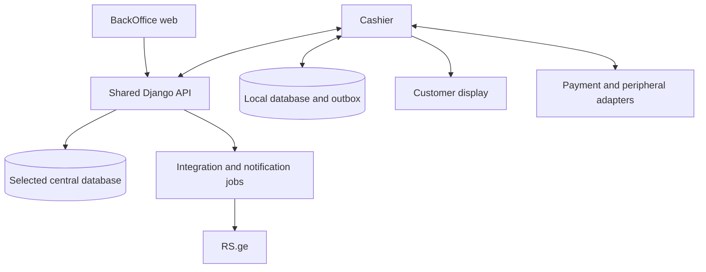

# SimplePOS architecture decision

Status: target architecture with an initial cash-checkout pilot now implemented. See the repository README and pilot setup guide for the exact implemented scope; later capabilities below remain design decisions.

## One shared backend, two interfaces

Keep the API inside the BackOffice backend initially, as a Django modular application. BackOffice is the administration product; its backend is also the authoritative service for Cashier. A separate API deployment is unnecessary until scaling or release needs justify it.

BackOffice and Cashier both use the same authenticated API; neither client has central database credentials. The customer display subscribes to the local Cashier sale, so basket updates work without cloud connectivity. API and jobs share domain services for stock, pricing and permissions. Network notifications are hints to retrieve durable changes, not the source of truth.

The implemented BackOffice uses Django templates, session authentication and CSRF protection, calling the same domain services in process. Cashier uses the HTTPS API. Django's default administration routes are disabled.

## Tenant and location model

Each customer receives one VM, one ERP installation and one selected database. Exactly one Company is allowed by a unique fixed installation slot and a database check constraint. There is no company creation screen after first-start setup. Existing company foreign keys remain to validate catalog, stock, user and register relationships and preserve historical IDs.

The pilot represents a branch or warehouse directly as a `Location`. A register belongs to a branch. Each product can have separate stock assignments at multiple locations without duplicating its catalog identity. A future multi-location branch model would require an explicit migration.

Validate relationships against the installation's company at the service and database boundaries; do not trust submitted company IDs. Employee permissions and cashier branch assignments remain server-enforced. PostgreSQL, MySQL and Microsoft SQL Server are selectable; changing the configuration does not convert existing data. Subscription/payment records, infrastructure credentials and VM lifecycle actions belong to a separate [control service](subscription-architecture.md), not the company ERP.

Product is a company-wide catalog identity. ProductLocation enables that product at one inventory location. StockBalance is unique per company, product and location. Balances are derived from auditable movements, with atomic posting and concurrency control. A branch total is an aggregation of its locations, never a second balance to add to those locations.

The **Add product** flow requires a branch stock location or warehouse. Initial quantity may be zero (the product is available at that location but not yet stocked). If nonzero, create an opening-stock document atomically with the assignment. Editing the product must not directly rewrite stock. The same product can later be assigned to other locations. CSV/XML imports also require a destination assignment; importing catalog details alone does not invent stock.

Transfers post linked source and destination movements in one transaction. Corrections use reversals/adjustments and retain history. Archive referenced records; hard-delete only unused drafts where permissions allow.

## RS.ge receiving

Downloading a waybill stages an external document. Receiving is a separate local stock operation requiring a destination, reviewed product/unit mappings, actual quantities and an audit trail. Source values stay unchanged. Store the document ID and each goods-line ID in addition to the local product ID and barcode.

Receiving unit cost must not silently overwrite retail price. Product matching uses verified barcode or a saved supplier mapping; a supplier code is not necessarily a globally unique barcode. Unknown or ambiguous rows require review. Partial receipts and discrepancies need explicit accounting and document states.

RS.ge confirmation/rejection is a separate external action from posting local stock. Do not perform either merely on refresh. Use a document revision and idempotency key to prevent duplicate receipt posting. Later supplier corrections produce a review task, not an automatic destructive stock rewrite. See [RS.ge field research](rs-ge.md).

## Price publishing and offline operation

1. BackOffice submits a price change and scope: all branches or selected branches. Validate permissions, tax configuration, effective time and optimistic version.
2. The API commits a versioned price schedule and an outbox event in the same transaction. A worker notifies connected Cashiers.
3. Cashier retrieves all changes after its last acknowledged cursor, checks completeness, applies a catalog version atomically and acknowledges it. Reconnection does the same catch-up; a missed push cannot lose a price change.
4. Show published/applied versions per terminal in BackOffice. A disconnected terminal continues with its last usable version and is visibly pending.
5. Freeze basket line price/tax/discount snapshots. Apply updates to subsequent sales unless an explicit operator action reprices the current basket. Completed receipts never change retrospectively.

The first implementation should have a durable transactional local database in an installed Cashier, with stable device and client-generated sale IDs. Local sale completion and outbox insertion are one transaction. The API validates each submission and enforces a tenant/device/sale unique key; the same ID and payload returns the existing acknowledgement, while the same ID with different content is rejected for review. Retain unacknowledged sales across restarts; retry with backoff and per-record results. Advance download cursors only after local commit.

Offline stock across several tills is eventually consistent. Decide how negative projected balances, revoked permissions, stale prices and refunds are handled before pilot. A local branch coordinator may later improve LAN coordination, but no internet dependency may be introduced into normal cash checkout. Bootstrap and device enrollment require connectivity. Authorized offline access uses a bounded cached policy; remote revocation cannot take effect on an unreachable terminal immediately.

Payment state is separate from upload state. Never mark an uncertain card transaction paid or retry the charge just because synchronization failed. Use bank references and reconciliation. Record cash change, tenders and refunds explicitly. Terminal integration must be verified against the chosen bank's protocol and hardware.

## Cashier software updates

Use the same central API for release metadata, authorized rollout policy and terminal status, with packages downloaded from the managed update server. Required updates can target selected branches and an earliest installation time. Optional daily checks can be disabled locally without disabling required policy delivery. An installed Cashier coordinates platform-specific update packages and acquires a local checkout maintenance lock only after the current customer is finished. Preserve the local database and upload outbox through restart and supported recovery. See [Cashier updates](cashier-updates.md) for the safety gate, offline behavior, Windows/Linux boundary and acceptance scenarios.

## Advertising

Support static PNG/JPEG/WebP, animated GIF, and video with codecs validated for the selected Cashier runtime (initial candidates MP4 and WebM). BackOffice stores original assets and validated playback variants; check actual media type, size, duration and dimensions. File extensions alone are insufficient.

A campaign has a playlist, target branches/registers, active period, time zone, priority and per-image/GIF duration; videos play to completion subject to configured limits. Download a versioned manifest and complete assets before switching playlists. Verify content hashes and switch atomically, with a storage quota and last-known-good cache. Skip corrupt/unsupported files without blocking the basket. Expired campaigns do not continue offline; show a neutral store fallback when no valid cached campaign remains.

Both displays show the same basket and playlist state below it. Video is muted by default. The cashier keeps product/category controls. Playback work must not interfere with scanning or payments.

## Naming and language

Keep stable internal keys and migration/app labels independent of marketing text. New interfaces read a product display name (default SimplePOS), company identity, theme tokens and locale. Store product translations separately from supplier source descriptions. Render money, quantities and dates by locale; use explicit decimal types and agreed rounding for server calculations. Preserve imported identifiers as strings at the boundary, including leading zeros.

## Implementation order and known prerequisites

The initial review found account-authorization defects, inconsistent permission identifiers, a password-creation defect and non-atomic/inconsistent legacy stock updates. The pilot restricts legacy user routes to platform administrators, corrects the permission/password defects, requires an environment secret and upgrades dependencies. New commerce services replace the old stock path for pilot operations; legacy stock code is not certified for production.

Build tenant/location models and stock services before RS.ge posting or production checkout. Then ship a vertical slice: product plus location, stock receipt, offline cash sale, reconnect and exactly-once server effects under retried submissions. Add bank adapters, media distribution, alerts and subscription enforcement after that slice is proven.

Acceptance scenarios include cross-company access rejection, concurrent last-item sales, failed transfer rollback, repeated RS refresh/receive, crash after local sale commit, lost server acknowledgement, prolonged disconnect, supplier correction, staged price update and expired/corrupt offline media.

## Pilot implementation decisions

The first pilot represents a branch or warehouse directly as a `Location`, with `StockItem` assignments and `StockMovement` history. A later multi-location branch model will require an explicit migration. Server database selection uses environment configuration and vendor-specific requirements; switching vendors does not migrate data. Cashier always uses embedded SQLite. See [pilot setup](pilot-setup.md) and the [future appliance](appliance.md).

The repository split removed legacy stock screens. The current custom BackOffice calls the commerce services and uses installation and employee permissions; the default Django admin is not exposed. Historical RS.ge research remains documentation, not a live integration.
